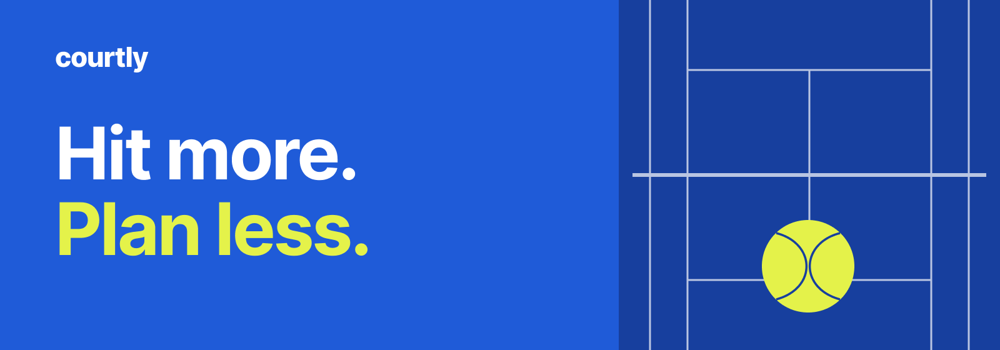
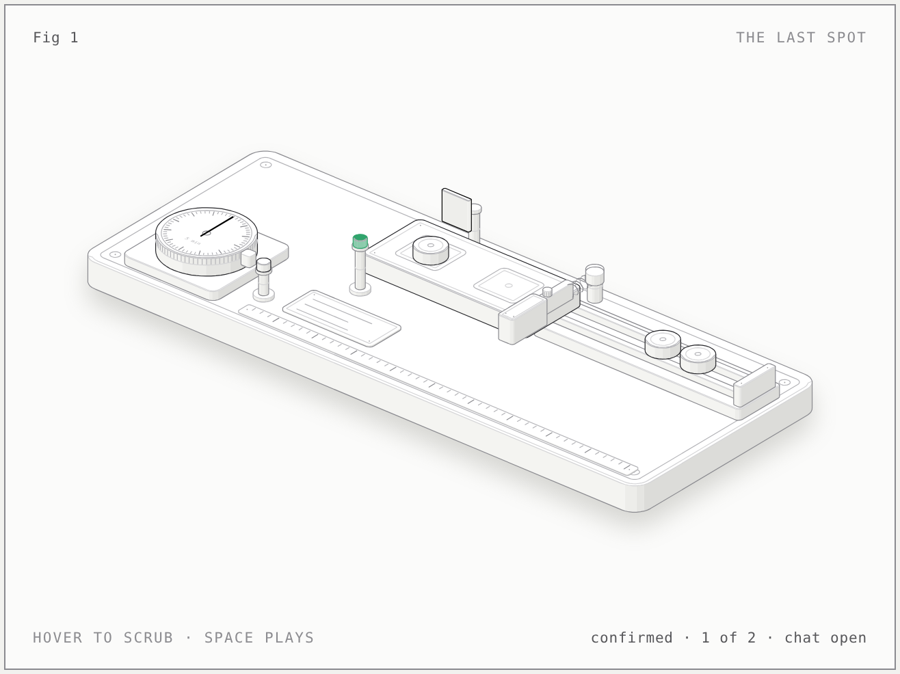
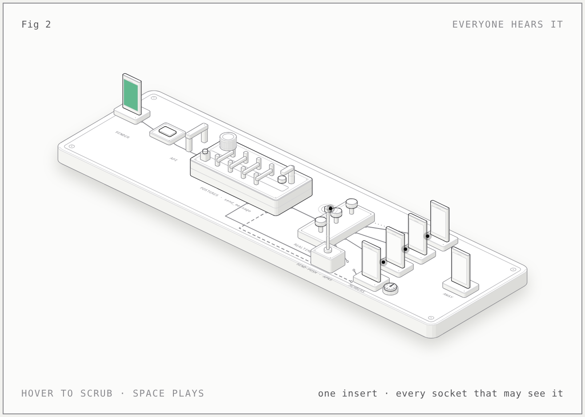
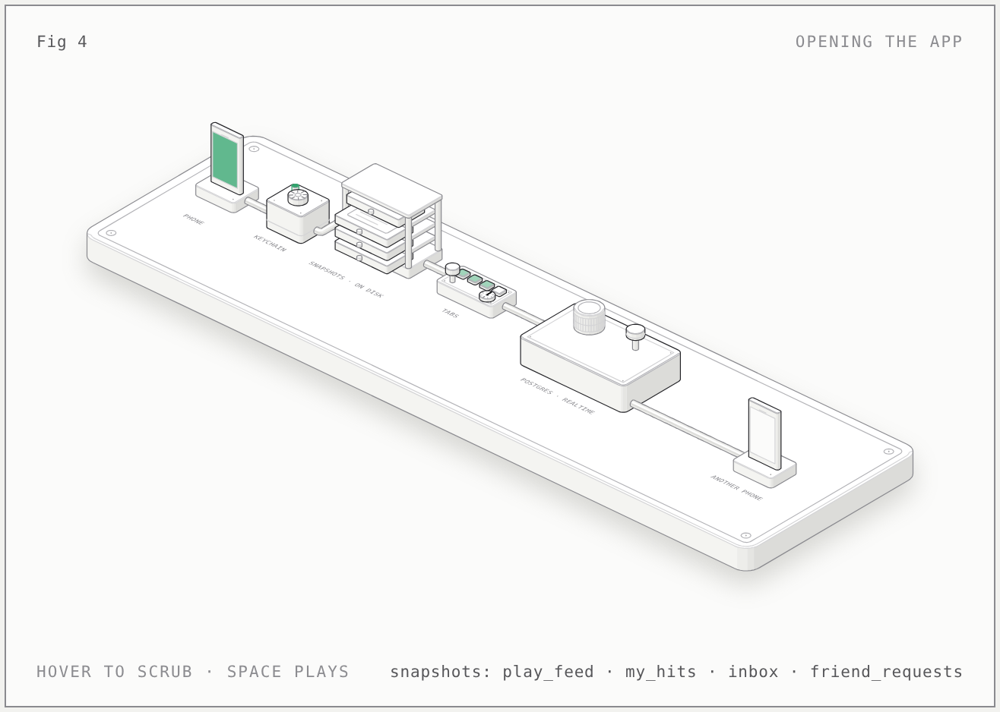
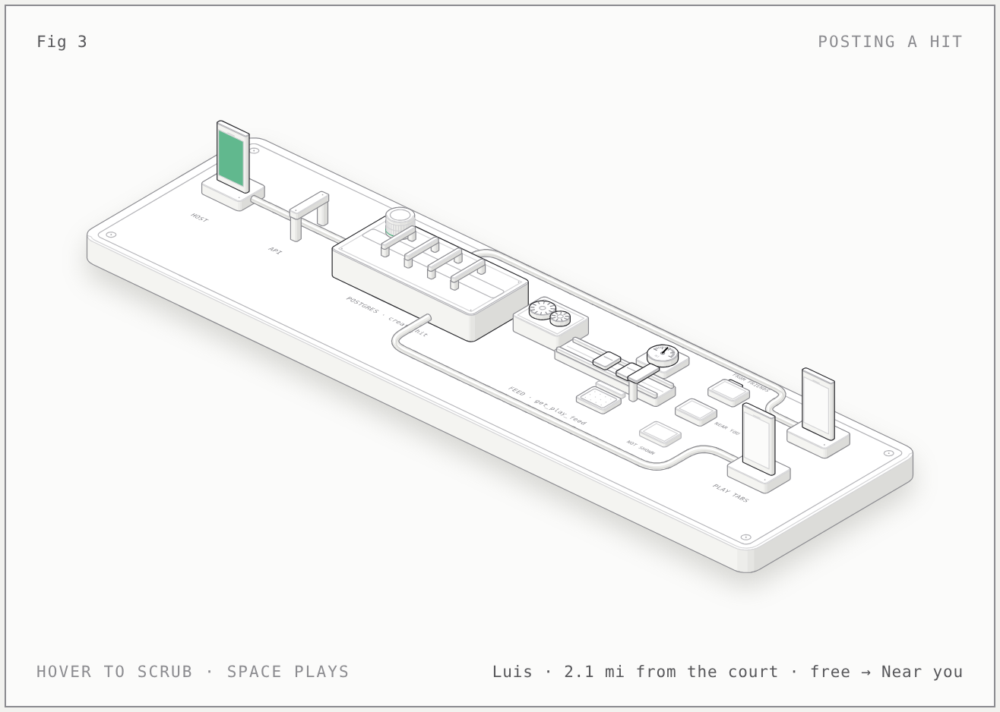

# Courtly

**Hit more. Plan less.**

Courtly is a native iOS app for finding people to play tennis with and turning a free afternoon into a hit. Find an open spot, pick a court, and work out the details together.

Currently in TestFlight testing. Built for players **18 and over**, on **iOS 17+**.

[Website](https://courtly-sage.vercel.app) · [iOS development](ios/README.md) · [Backend](supabase/README.md) · [MIT license](LICENSE)

## Find a hit, or make one

A **hit** is a tennis session with a start time, court, format, and open spots.

- **Explore:** browse one list of available hits, including friends’ posts, or narrow it to Friends. Distance is unrestricted by default. Sort by closest or soonest. Closest sorting favors friends when distances tie.
- **Find a time that works:** filter by day, date range, morning/afternoon/evening, or an exact time window. Add format, player level, and distance filters when you need them.
- **Plan a hit:** choose a day and start time, with no required duration. Search a full street address, court, or place name, check the map pin, and add the court’s name, surface, and lighting details. Choose casual hitting, singles, doubles, or drills, and who can join.
- **Join and organize:** request a spot, respond to invitations, or invite friends and groups. Hosts manage requests and participants; My Hits keeps upcoming and past sessions together.
- **Stay in touch:** find players by name, manage friend requests, and message friends, groups, or the people in your hit. Notifications cover requests, invitations, messages, and reminders.
- **Manage your account:** update your profile and preferences in Settings, control notifications and visibility, block or report players, and delete your account.

Courtly helps arrange a session; it does not reserve courts. Court times use the court’s time zone. Court search is not restricted to the original Palm Beach County seed locations, though results depend on Apple Maps coverage.

## Run locally

You need a Mac with **Xcode 26 or newer**. The app supports iOS 17+, but building it requires the newer SDK. No third-party Swift packages are required.

```sh
git clone https://github.com/Charanjarugula/Congressional_app_challenge.git
cd Congressional_app_challenge
open ios/Courtly.xcodeproj
```

Choose the **Courtly** scheme, select an iPhone simulator, and press Run. Sign in with Apple, Google, or an email code. For a physical device, configure your development team under Signing & Capabilities.

### Development and production are separate

| Scheme / build | Backend | Use |
|---|---|---|
| Courtly / Debug | Development | Everyday development and test accounts |
| Courtly Production / Release | Production | Checking the same accounts and hits as TestFlight |
| TestFlight | Production | Testing distributed builds on devices |

Accounts, friendships, messages, and hits do **not** cross between environments. If two people cannot find each other, first check that both builds use the same backend. Use dedicated test accounts; actions in the production scheme affect real data.

The checked-in [AppConfig.swift](ios/Courtly/Config/AppConfig.swift) contains project URLs and public client keys. Private signing keys, service credentials, and account codes do not belong in the repository.

## Test

In Xcode, use **⌘U** with the `Courtly` scheme for unit tests or `CourtlyUITests` for UI tests. From the repository root:

```sh
# Debug build; use -configuration Release to check the release configuration.
xcodebuild build -project ios/Courtly.xcodeproj -scheme Courtly \
  -configuration Debug -destination 'generic/platform=iOS Simulator' \
  CODE_SIGNING_ALLOWED=NO

# List available simulators, then substitute one UUID below.
xcrun simctl list devices available
xcodebuild test -project ios/Courtly.xcodeproj -scheme Courtly \
  -destination 'platform=iOS Simulator,id=SIMULATOR_UUID'

# Run the UI suite on that simulator.
xcodebuild test -project ios/Courtly.xcodeproj -scheme CourtlyUITests \
  -destination 'platform=iOS Simulator,id=SIMULATOR_UUID'
```

The UI suite includes a live Apple Maps address-search check, which needs network access. The separate App Review screenshot capture requires credentials and is skipped in ordinary runs.

For interaction changes, also run the [two-account simulator walkthrough](ios/README.md#two-account-interaction-check): discover each other, send and accept requests, create and join hits, and exchange messages. Both accounts must use the same backend. Fixture tests alone do not prove those interactions work.

Backend checks apply the migrations, seed data, and smoke tests to a disposable Postgres 16 database. See the [backend guide](supabase/README.md) before running the harness—it drops and recreates its test database.

## Codebase

The app uses SwiftUI, shared design components, and observable session/store state. Typed API calls go through `URLSession` to Supabase database functions. Postgres/PostGIS handles location data and application rules; Auth, Storage, and Realtime provide sign-in, photos, and live updates. Row-level security and explicit caller checks protect data access. Deno Edge Functions handle push delivery, account deletion, Apple token exchange, and report emails.

| Path | Contents |
|---|---|
| [ios/Courtly](ios/Courtly) | App, design system, features, models, and services |
| [ios/CourtlyTests](ios/CourtlyTests) / [ios/CourtlyUITests](ios/CourtlyUITests) | Unit and UI tests |
| [supabase](supabase/README.md) | Migrations, Edge Functions, seed data, smoke tests, and deployment notes |
| [scripts](scripts/README.md) | Backend deployment and TestFlight upload tools |
| [site](site/README.md) | Static website, policies, and support pages |
| [.github/workflows](.github/workflows) | Builds, tests, deployment, and screenshot capture |

Some source folders retain earlier names: `Features/Play` implements Explore and `Features/You` implements Settings.

### How it works, drawn

[`docs/figures`](docs/figures/README.md) holds interactive figures of the mechanisms that are hardest to see from the screens. Each is a small machine whose motion is the mechanism, with every number taken from the code it names.

<p align="center">
  <a href="docs/figures/last-spot/index-light.html"></a>
</p>

*The last spot.* Accepting a player locks the hit's row first, so two accepts at the same moment take turns; the first player confirms the hit and opens its chat in the same transaction; a full hit turns the rest away; the scheduler ticks every five minutes and sends each reminder once.

<p align="center">
  <a href="docs/figures/everyone-hears-it/index-light.html"></a>
</p>

<p align="center">
  <a href="docs/figures/opening-the-app/index-light.html"></a>
</p>

*Opening the app.* The session tokens in the keychain are checked, and every tab paints from the copy of its data saved on the phone before the network answers; the fresh copies replace them and are saved back, so the app opens in one frame and works offline; a burst of Realtime changes starts one 400 ms timer and ends in one refresh.

<p align="center">
  <a href="docs/figures/posting-a-hit/index-light.html"></a>
</p>

*Posting a hit.* `create_hit` refuses a start under 15 minutes away or over 30 days out, more than 7 spots or a 21st hit in a day, then stores the row; `get_play_feed` builds each player's list on request from friendship, the distance from the court to their home point over a spatial index, and the hours they marked busy; phones with Play open hear the insert and refresh once.

*Everyone hears it.* The sender's phone shows a message at once as a hollow card tagged with a client id and calls `send_message`; the database checks membership, blocks, words and the rate limit in that order, stores the row and stamps its id; the insert reaches every phone allowed to see it over one socket each, a phone whose socket is down polls instead, a phone that is away gets a push, and the same tag sent twice returns the stored row.

## Contributing and releases

Branch from `main` and open a focused pull request. Describe the behavior change and how it was tested. Keep database migrations append-only, and add regression coverage for changes to application rules.

GitHub Actions checks Debug and Release builds, unit and UI tests, and backend changes. Merging backend changes deploys development automatically; production deployment is explicit. Apply required backend migrations before distributing an app build that depends on them.

[scripts/testflight.sh](scripts/testflight.sh) archives and uploads a Release build using App Store Connect credentials configured locally. Its `--archive-only` option builds without uploading. See the [script guide](scripts/README.md) and [backend deployment guide](supabase/README.md#deploying-the-backend) for details.

## Support and license

For app support, contact [courtly.support@gmail.com](mailto:courtly.support@gmail.com). Bugs and development suggestions can be filed as [GitHub issues](https://github.com/Charanjarugula/Congressional_app_challenge/issues). Please leave account codes and private user data out of public reports.

[Privacy](https://courtly-sage.vercel.app/privacy) · [Terms](https://courtly-sage.vercel.app/terms)

Built by **Charan Jarugula and Maddox Tse**. Licensed under [MIT](LICENSE). The website’s Nunito typeface is distributed under the [SIL Open Font License](site/fonts/OFL.txt).
