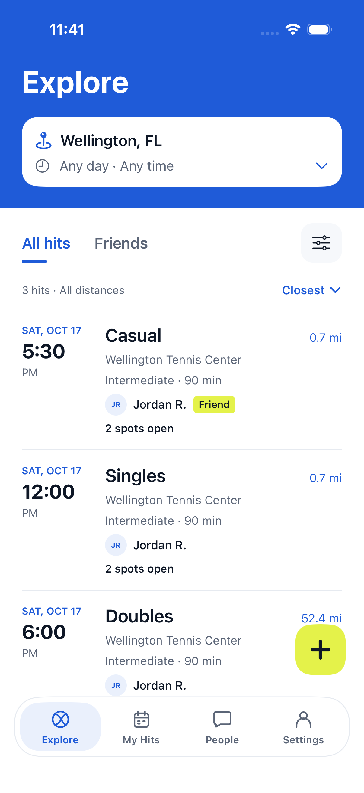
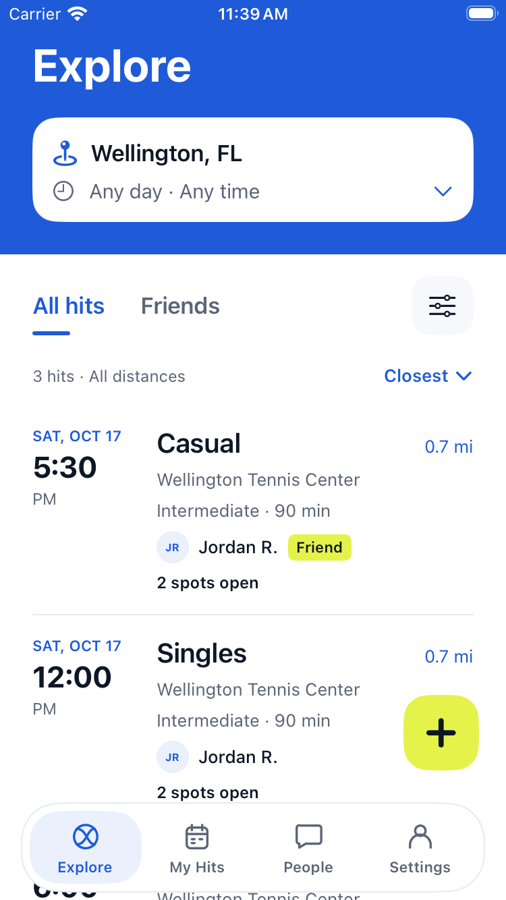

# Explore redesign — simulator validation

Tested October 16, 2026 against the approved [Explore Figma frames](https://www.figma.com/design/LR6Kq67WXL07ixTesgCwvC?node-id=85-211). Bottom tab styling is deliberately unchanged. This change is stacked on PR #76 (`fix/layout-and-discovery`); its existing backend discovery fixes must land first.

## Results

| Check | Result |
| --- | --- |
| Debug build / Courtly unit suite | Pass: 57 tests, including 11 Explore tests |
| Release simulator build | Pass |
| ExploreFlowTests — iPhone 17, iOS 26.5 | Pass: 4 tests |
| ExploreFlowTests — iPhone SE (3rd generation), iOS 26.5 | Pass: 4 tests |
| Real city lookup | Miami, FL resolved; distances recalculated to 61.3 mi for the fixture court |
| Visual review | Standard and small screens, larger text, search/filter sheets, existing detail and planning destinations |

The simulator tests render the production `PlayView`, search/filter sheets, and existing detail/planning views. Their session and feed are simulator-only fixtures, not production data. The fixtures include duplicate listings, equally distant friend/non-friend hits, a 52.4-mile hit, and a stale invitation for an already-joined player.

Covered: deduplication; default closest ordering and friend tie-breaking; explicit soonest ordering; scope changes; format/distance filters; cancel/apply/reset; empty-state recovery; tomorrow/afternoon and exact-time controls; direct detail navigation and return with search state retained; opening/cancelling planning; larger-text selection controls. Unit coverage additionally checks eligibility by hit status/time, pending requests, court-local day/time boundaries, level combinations, unknown distances and search-area distance recalculation without mutating the feed.

Search is temporary and does not update profile preferences. Selected dates and start times are evaluated in the court’s timezone. No calendar/availability integration is added. The backend’s existing eligibility and busy-time rules remain unchanged in this PR.

**Limits:** this is not a two-account live interaction walkthrough. The available normal simulator session was signed out; authenticated joining, posting and synchronization were not exercised. Planning navigation and cancellation passed, but successful posting needs an authenticated account. No physical-device validation or TestFlight upload was performed for this change. UI-only fixture success does not establish backend action success.

## Reproduce

Run the `Courtly` scheme with `-only-testing:CourtlyTests`, and the `CourtlyUITests` scheme with `-only-testing:CourtlyUITests/ExploreFlowTests`. Use each simulator destination; the UI tests install their fixture entry point via `--explore-ui-checks`. This entry point is excluded from device and Release builds.

## Screenshots

The example names and listings below are test fixtures only.

| iPhone 17 | iPhone SE |
| --- | --- |
|  |  |

[View larger-text layout](explore-redesign/large-text.png).
